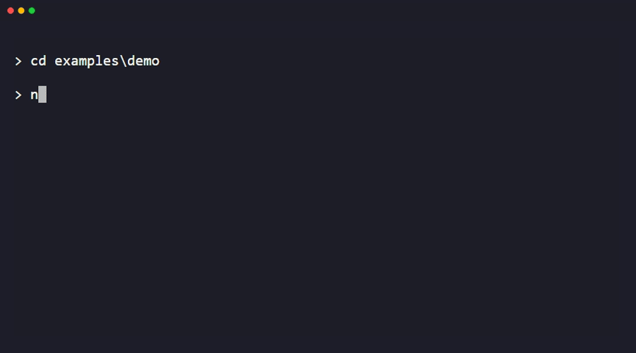

# @idlesummer/pen

> A React framework for building simple terminal UIs, built on Vite and Ink, with file-based routing modeled after Next.js’s App Router.

> [!NOTE]
> Early-stage — API may still change.

Pen renders React components to the terminal via [Ink](https://github.com/vadimdemedes/ink), and adds its own: file-based routing, a dev server with Fast Refresh, and a production build through [Vite](https://github.com/vitejs/vite).

## Usage

```tsx
// src/app/page.tsx
import { useState, useEffect } from 'react'
import { Box, Text } from 'ink'

export default function RootPage() {
  const [count, setCount] = useState(0)

  useEffect(() => {
    const interval = setInterval(() => setCount(c => c + 1), 1000)
    return () => clearInterval(interval)
  }, [])

  return (
    <Box borderStyle="round" paddingX={1} alignSelf="flex-start">
      <Text color="green">Count: {count}</Text>
    </Box>
  )
}
```



Edit the file and the terminal updates in place via Fast Refresh. No restart, no re-render flash.

Fast Refresh is native to pen.

<!--
Consider swapping the terminal block above for an actual recording
(asciinema, vhs, or a GIF) once the README is otherwise settled - stronger
first impression than a static block, but not worth blocking the draft on.
-->

## Contents

- [Getting started](#getting-started)
- [Routing conventions](#routing-conventions)
- [Hooks](#hooks)
- [Functions](#functions)
- [CLI reference](#cli-reference)
- [Configuration](#configuration)
- [Examples](#examples)
- [Debugging with React DevTools](#debugging-with-react-devtools)
- [Requirements](#requirements)

## Getting started

```bash
npx @idlesummer/pen create my-app
cd my-app
npm install
npx pen dev
```

Omit the name to scaffold into the current directory instead: `npx @idlesummer/pen create`.

## Routing conventions

Routes live under `src/app/`. A folder becomes a route once it has a `page.tsx`; everything else below is optional and composes around it.

### page.tsx

The route's content - the component rendered for that path.

```tsx
export default function Page() {
  return <Text>...</Text>
}
```

### layout.tsx

Wraps the route and everything nested under it. Re-used across navigations within it instead of remounting.

```tsx
import type { PropsWithChildren } from 'react'
import { Box } from 'ink'

export default function Layout({ children }: PropsWithChildren) {
  return <Box flexDirection="column">{children}</Box>
}
```

### loading.tsx

Shown while the route suspends (e.g. data fetching). Wraps the route in a `Suspense` boundary automatically - no need to add one yourself.

```tsx
export default function Loading() {
  return <Text>Loading...</Text>
}
```

### error.tsx

Shown if the route throws during render. Receives the error and a `reset` function to retry.

Type: `FunctionComponent<{ error: Error, reset: () => void }>`

```tsx
import type { ErrorFallbackProps } from '@idlesummer/pen'

export default function Error({ error, reset }: ErrorFallbackProps) {
  return <Text>{error.message}</Text>
}
```

### fallback.tsx

Rendered when [`showFallback()`](#showFallback) is called from this position, or from a parallel slot with no matching route.

Type: `FunctionComponent<{ params: MatchParams }>`

```tsx
export default function Fallback() {
  return <Text>Not found</Text>
}
```

### Dynamic segments

`[id]/` matches any single path segment. Read it via [`useRoute()`](#useroute) or a route param, depending on how your page reads params.

### Catch-all segments

`[...ids]/` matches one or more path segments.

### Parallel routes

`@slotName/` renders alongside its parent, independently of the main route - useful for things like a persistent sidebar that doesn't remount when the main content navigates.

## Hooks

### useRoute()

Returns the current route as a plain string. Re-renders the calling component when navigation changes it.

```tsx
import { useRoute } from '@idlesummer/pen'

function CurrentPath() {
  const route = useRoute()
  return <Text>{route}</Text>
}
```

### useNavigate()

Returns the full navigation state: the visited-route stack, the current position within it, and a refresh counter. Re-renders the calling component on any navigation change.

Type: `{ history: string[], position: number, refreshes: number }`

```tsx
import { useNavigate } from '@idlesummer/pen'

function DebugState() {
  const { history, position } = useNavigate()
  return <Text>{position + 1} / {history.length}</Text>
}
```

### useHistory()

A narrower `useNavigate()` - just the visited-route stack and the current position, under `stack`/`position` instead of `history`/`position`.

Type: `{ stack: string[], position: number }`

### useRouter()

Returns the navigation actions, without subscribing the calling component to state changes - use this when you only need to *trigger* navigation, not read it.

Type: `{ push(route: string): void, replace(route: string): void, back(): void, forward(): void, refresh(): void }`

```tsx
import { useInput } from 'ink'
import { useRouter } from '@idlesummer/pen'

function BackOnEscape() {
  const router = useRouter()
  useInput((input, key) => {
    if (key.escape) router.back()
  })
  return null
}
```

## Functions

### showFallback()

Call from anywhere in a route's render to replace its content with the nearest [`fallback.tsx`](#fallbacktsx) - similar idea as Next.js's own `notFound()`.

```tsx
import { showFallback } from '@idlesummer/pen'

export default function UserPage({ params }: { params: MatchParams }) {
  if (!userExists(params.id))
    showFallback()
  return <Text>...</Text>
}
```

## CLI reference

### pen create [name]

Scaffold a new pen project. Omit `name` to scaffold into the current directory.

### pen dev

Start the development server - Fast Refresh, route hot-reloading, and route add/remove detection.

### pen build

Compile routes and bundle the app with Vite, for production.

### pen start

Run the app built by `pen build`.

## Configuration

Create a `pen.config.ts` at your project root:

```ts
import { defineConfig } from '@idlesummer/pen'

export default defineConfig({
  reactCompiler: false,
  reactStrictMode: true,
  ink: { maxFps: 75 },
  watch: { usePolling: false },
})
```

### reactCompiler

Type: `boolean`\
Default: `false`

Runs React Compiler over your components. Experimental - see [oxc-transform-react](https://www.npmjs.com/package/oxc-transform-react)'s own README before enabling it.

### reactStrictMode

Type: `boolean`\
Default: `true`

Wraps the app in React's `StrictMode` during `pen dev` - same idea as Next.js's own `reactStrictMode` option. Dev-only; set to `false` to opt out.

### ink

Type: `RenderOptions` (Ink's own)\
Default: `{ maxFps: 75 }`

Forwarded directly to Ink's own `render()` call.

### watch.usePolling

Type: `boolean`\
Default: `true` on Windows, `false` elsewhere

Use polling instead of native filesystem events for the dev server's file watcher. Native events can stop detecting changes after a directory is deleted on Windows - also worth enabling on Docker or network-mounted volumes.

## Examples

[`examples/basic-app`](examples/basic-app) in this repo - nested layouts, dynamic and catch-all segments, a parallel route, and loading/error boundaries, all in one app.

## Debugging with React DevTools

Ink supports [React DevTools](https://github.com/vadimdemedes/ink#using-react-devtools) out of the box, and since pen is built on Ink, the same workflow works here.

1. Install the optional dependency:
   ```bash
   npm install -D react-devtools-core
   ```
2. **On Node 24.16+ or 26.1+**, you'll also need to override `electron`'s version in your own `package.json` - `react-devtools`'s own pinned electron version has a known install bug on newer Node ([electron/electron#51619](https://github.com/electron/electron/issues/51619)):
   ```json
   "overrides": {
     "react-devtools": {
       "electron": "^42.11.3"
     }
   }
   ```
3. Start the standalone app in one terminal:
   ```bash
   npx react-devtools
   ```
4. Run your dev server in another:
   ```bash
   npx pen dev
   ```
   `DEV=true` is already set for you when running `dev` command.

Your component tree shows up in the DevTools window, updating live as you navigate.

## Requirements

- Node.js >= 26
- React ^19.2.8
- Ink ^7.1.1

## License

[MIT](./LICENSE) © Nash Luis Maramag
